# Projet DevSecOps : sécurisation de l'application LiveChat

- **Module** : DevSecOps, Master DevOps et Cloud Computing
- **Université** : Abdelmalek Essaâdi, Faculté Polydisciplinaire de Larache
- **Année universitaire** : 2026/2027
- **Encadrant** : Mohamed KOUISSI
- **Groupe** : G2
- **Membres** :
  - Hajar EL BACHIRI
  - Keltouma ACHGUER
  - Mohamed El Amine HOUMADA
- **Application analysée** : LiveChat, application web de messagerie en temps réel en Java/Maven (Jakarta EE, JSP, WebSocket, Hibernate, MySQL)

## Présentation du projet

Ce dépôt regroupe les workshops du module DevSecOps. Ils sont tous réalisés sur **une seule application, LiveChat**. À chaque workshop, nous ajoutons une couche de sécurité différente, afin de construire progressivement une démarche DevSecOps complète, du code source jusqu'au déploiement et à l'exploitation.

Le principe suivi est le *Shift Left* : détecter les problèmes de sécurité le plus tôt possible dans le cycle de développement, grâce à des outils automatisés intégrés dans un pipeline CI/CD (GitHub Actions).

| Workshop | Thème | Type de test | Outils | Ce qui est analysé |
|---|---|---|---|---|
| 2 | Sécurité du code source | SAST | SonarQube, Semgrep | Le code source |
| 3 | Sécurité des dépendances | SCA | Dependabot, OWASP Dependency-Check | Les bibliothèques tierces |
| 4 | Détection automatique des vulnérabilités web | DAST | OWASP ZAP | L'application en exécution |

*Ce tableau et le sommaire sont complétés au fur et à mesure des workshops suivants.*

Les approches des workshops 2 à 4 sont complémentaires : le SAST analyse ce que nous écrivons, le SCA analyse ce que nous importons, et le DAST teste ce que nous déployons.

## Sommaire

- [Workshop 2 : Analyse de la qualité et de la sécurité du code (SAST)](#workshop2)
- [Workshop 3 : Sécurité des dépendances (SCA)](#workshop3)
- [Workshop 4 : Détection automatique des vulnérabilités web (DAST)](#workshop4)
<!-- Ajouter ici les prochains workshops -->

---

<a id="workshop2"></a>

## Workshop 2 : Analyse de la qualité et de la sécurité du code (SAST)

### 1. Présentation du projet

Ce workshop a pour objectif d'analyser la qualité et la sécurité du code source à l'aide de SonarQube et de Semgrep, puis d'intégrer une analyse automatisée de sécurité dans un pipeline CI avec GitHub Actions.

Les objectifs sont :
- Détecter les problèmes de qualité et les vulnérabilités potentielles.
- Analyser le code source avec deux outils complémentaires.
- Automatiser l'analyse de sécurité à chaque modification du dépôt.
- Identifier et corriger les problèmes détectés.

### 2. Outils et technologies utilisés

- **Git et GitHub** : gestion du code source et du dépôt.
- **SonarQube** : analyse de la qualité du code et détection des problèmes.
- **Semgrep** : analyse statique du code et détection des problèmes de sécurité.
- **GitHub Actions** : automatisation de l'analyse dans un pipeline CI.
- **Docker** : exécution de SonarQube et Semgrep dans un conteneur.

### 3. Analyse avec SonarQube

SonarQube a été utilisé pour analyser le projet et examiner les indicateurs de qualité et les problèmes détectés.

Cette analyse permet notamment d'identifier :
- Les bugs potentiels.
- Les vulnérabilités de sécurité.
- Les code smells.
- Les indicateurs de qualité du projet.

#### Captures d'écran


*Figure 1 : Tableau de bord général de SonarQube.*


*Figure 2 : Résultats et problèmes de sécurité détectés par SonarQube.*


*Figure 3 : Résultats et problèmes de fiabilité détectés par SonarQube.*


*Figure 4 : Résultats et problèmes de maintenabilité détectés par SonarQube.*

### 4. Analyse de sécurité avec Semgrep

Semgrep a été utilisé pour effectuer une analyse statique du code source.

La commande utilisée est :

```bash
docker run --rm \
  --mount "type=bind,source=$($PWD.Path),target=/src" \
  -w /src \
  semgrep/semgrep \
  semgrep scan --config auto .
```

Lors de l'analyse, Semgrep a examiné les fichiers suivis par Git et a notamment signalé :

<!-- nosemgrep: javascript.lang.security.detect-insecure-websocket.detect-insecure-websocket -->
- Une utilisation de `ws://` dans `src/main/webapp/chat.jsp`, correspondant à une connexion WebSocket non chiffrée.
- Une référence de version mutable `actions/checkout@v4` dans le workflow GitHub Actions.

Ces résultats ont permis d'identifier des améliorations possibles concernant la sécurisation des communications et la chaîne d'approvisionnement logicielle.

#### Captures d'écran


*Figure 5 : Résultats de l'analyse statique avec Semgrep avant correction.*


*Figure 6 : Résultats de l'analyse statique avec Semgrep après correction.*


*Figure 7 : Résultats de l'analyse statique avec Semgrep après re-correction.*

### 5. Intégration dans un pipeline CI

Un workflow GitHub Actions a été créé dans le fichier :

`.github/workflows/semgrep.yml`

Le pipeline est déclenché lors :
- D'un `push` sur la branche `main`.
- D'une pull request ciblant `main`.
- D'un lancement manuel du workflow.

Le pipeline récupère le code source, exécute Semgrep et utilise le résultat de l'analyse pour déterminer si l'étape de sécurité réussit ou échoue.

Cette intégration permet de détecter automatiquement certains problèmes de sécurité au cours du développement.

#### Capture d'écran


*Figure 8 : Intégration et exécution du pipeline CI sur GitHub Actions.*

### 6. Corrections et vérifications

Les analyses ont permis d'identifier des problèmes potentiels dans le code applicatif et dans la configuration du pipeline.

Les actions envisagées ou réalisées comprennent :
- L'adaptation du protocole WebSocket pour utiliser une connexion sécurisée en production avec HTTPS/WSS.
- Le verrouillage de l'action GitHub `actions/checkout` sur un SHA de commit précis.
- La relance de l'analyse Semgrep après les modifications.
- La vérification de la compilation, des tests et du fonctionnement de l'application.

Les corrections sont considérées comme validées après vérification des résultats des analyses et des tests.

### 7. Conclusion

L'utilisation combinée de SonarQube, Semgrep et GitHub Actions permet d'améliorer le suivi de la qualité et de la sécurité du projet.

SonarQube fournit une vue d'ensemble de la qualité du code, tandis que Semgrep permet de détecter des problèmes de sécurité potentiels. L'intégration de Semgrep dans un pipeline CI automatise ces vérifications et facilite la détection précoce des problèmes lors des modifications du code.

Cette réalisation constitue une première étape vers une démarche d'intégration continue intégrant des contrôles de qualité et de sécurité.

---

<a id="workshop3"></a>

## Workshop 3 : Sécurité des dépendances (SCA)

**Dependabot et OWASP Dependency-Check**

- **Dépôt d'origine du workshop** : https://github.com/MohamedElAmineHoumada/workshop3-G2

### 1. Objectif

Sécuriser les dépendances d'un projet Maven en utilisant :
- **Dependabot** : détection des dépendances vulnérables et mises à jour automatiques via des Pull Requests.
- **OWASP Dependency-Check** : analyse SCA qui compare les dépendances à la base NVD pour détecter les CVE.

Ces outils s'intègrent dans un pipeline CI/CD (GitHub Actions) pour appliquer le principe du *Shift Left*.

### 2. Définitions

|         Terme          |                                  Définition                                  |
|------------------------|------------------------------------------------------------------------------|
| Dépendance             | Bibliothèque externe utilisée par le projet, déclarée dans `pom.xml`         |
| Dépendance transitive  | Dépendance non déclarée directement, apportée par une autre dépendance       |
| CVE                    | Identifiant public d'une faille de sécurité connue                           |
| CVSS                   | Score de gravité d'une CVE, de 0 à 10                                        |
| SCA                    | Software Composition Analysis : analyse des composants tiers                 |
| NVD                    | National Vulnerability Database : base publique des CVE (NIST)               |
| Dependabot             | Outil GitHub qui alerte et propose des mises à jour de dépendances           |
| OWASP Dependency-Check | Outil SCA qui détecte les dépendances ayant des CVE connues                  |
| Pull Request (PR)      | Proposition de modification à relire avant fusion dans la branche principale |

### 3. Environnement de travail

Outils utilisés :
- Git, GitHub (dépôt + GitHub Actions)
- Java 26 et Maven 3.9.16 (via mvnd 1.0.6) en local ; le workflow GitHub Actions utilise Java 17 (Temurin), installé automatiquement
- Éditeur : Visual Studio Code


### 4. Mise en place du dépôt

Le dépôt `workshop3-G2` a été créé sur GitHub et alimenté avec le code du projet Live Chat. Le `pom.xml` déclare les dépendances suivantes :

|                      Dépendance                      |          Rôle           |
|------------------------------------------------------|-------------------------|
| Jakarta EE (Servlet, JSP/JSTL, WebSocket, JSON, EL)  | API web et temps réel   |
| `jakarta.persistence-api` / `hibernate-core`         | Accès aux données (ORM) |
| `mysql-connector-j` 8.0.33 (initialement)            | Connexion à MySQL       |
| `gson` 2.12.1                                        | Sérialisation JSON      |
| `junit-jupiter` 5.10.2                               | Tests                   |

> Versions du `pom.xml` initial. `mysql-connector-j` a ensuite été mis à jour en 8.2.0 (voir section 9).


### 5. Pipeline CI : build Maven

Le workflow `.github/workflows/ci.yml` se déclenche à chaque `push` et pull request vers `main`, ainsi qu'à la demande (`workflow_dispatch`). Étapes :

1. **Checkout** du code.
2. **Set up JDK 17** (Temurin) avec cache Maven.
3. **Build with Maven** (`mvn clean verify`).
4. **Restore** du cache de la base de vulnérabilités.
5. **Run OWASP Dependency-Check** (voir section 10), avec clé API NVD et miroir de données.
6. **Save** du cache de la base, même en cas d'échec de l'étape précédente.
7. **Upload** du rapport (HTML et JSON) comme artefact du run.


### 6. Dependabot : configuration

Le fichier `.github/dependabot.yml` définit ce que Dependabot surveille.

```yaml
version: 2
updates:
  - package-ecosystem: "maven"
    directory: "/"
    schedule:
      interval: "weekly"
```

|      Paramètre      |                              Rôle                              |
|---------------------|----------------------------------------------------------------|
| `version: 2`        | Version du format de configuration                             |
| `package-ecosystem` | Type de dépendances à surveiller (ici `maven`)                 |
| `directory`         | Dossier où se trouve le fichier de dépendances (`/` = racine)  |
| `schedule.interval` | Fréquence de vérification (ici `weekly`, une fois par semaine) |

Cette configuration est à l'origine des 5 Pull Requests présentées en section 8.


### 7. Dependabot Alerts : état initial

Nous avons activé **Dependency graph** et **Dependabot alerts** dans *Settings → Advanced Security*. GitHub détecte **1 alerte** de gravité **High** :

|         Dépendance         |                 Alerte                  | Gravité |  Fichier  |
|----------------------------|-----------------------------------------|---------|-----------|
| `mysql-connector-j` 8.0.33 | MySQL Connectors takeover vulnerability | High    | `pom.xml` |

Cette alerte correspond à la CVE-2023-22102 : la version utilisée du connecteur MySQL contient une faille connue, corrigée à partir de la version 8.2.0 (voir section 9).


### 8. Pull Requests de Dependabot

Dependabot a ouvert **5 PRs** de mise à jour. Chacune comporte une description (avec un indicateur de compatibilité) et propose la modification du `pom.xml`.


#### Analyse

| PR |                 Mise à jour                  |    Type     | Conflit |  Décision |
|----|----------------------------------------------|-------------|---------|-----------|
| #1 | `jakarta.persistence-api` 3.1.0 → 3.2.0      | Mineure     | Aucun   | Fusionnée |
| #2 | `jakarta.servlet.jsp.jstl-api` 3.0.0 → 3.0.2 | Correctif   | Aucun   | Fusionnée |
| #3 | `maven-compiler-plugin` 3.11.0 → 3.16.0      | Mineure     | Aucun   | Fusionnée |
| #4 | `jakarta.servlet.jsp-api` 3.1.0 → 4.0.0      | **Majeure** | Aucun   | Fusionnée |
| #5 | `jakarta.websocket-api` 2.1.0 → 2.2.0        | Mineure     | Aucun   | Fusionnée |

Règle appliquée : une PR est fusionnée si elle n'a pas de conflit avec `main`. Une mise à jour **majeure** (comme la PR #4, `jakarta.servlet.jsp-api` 3.1.0 → 4.0.0) peut casser la compatibilité (API changée, serveur d'application incompatible) : elle doit être testée après fusion.

Les 5 PRs ouvertes par Dependabot ont été fusionnées une par une dans `main`. Après les fusions, l'onglet *Pull requests* affiche **0 PR ouverte et 5 fermées**.

Après les fusions et la mise à jour de `mysql-connector-j`, le pipeline GitHub Actions s'exécute avec succès (job `build-and-scan` au vert). La montée de version majeure de `jakarta.servlet.jsp-api` n'a pas fait échouer le build.


### 9. Résultat après fusion

Les PRs ci-dessus sont des *version updates* : elles maintiennent les dépendances à jour mais ne ciblent pas spécifiquement la dépendance vulnérable. Après leur fusion, l'alerte sur `mysql-connector-j` restait donc ouverte. Deux solutions existent :
- activer les **Dependabot security updates** (*Settings → Advanced Security*) : Dependabot ouvre alors une PR de correction pour l'alerte ;
- ou modifier manuellement la version dans `pom.xml` vers une version corrigée.

Nous avons choisi la correction manuelle : `mysql-connector-j` 8.0.33 → **8.2.0** (version qui corrige la CVE-2023-22102), commit « Update mysql-connector-j to 8.2.0 (CVE-2023-22102) ». Après le push, le pipeline est passé au vert et l'alerte est **fermée** (onglet Dependabot : Open 0, Closed 1).


### 10. OWASP Dependency-Check

#### 10.1 Principe

Le plugin Maven `dependency-check-maven` (version 13.0.0) analyse les dépendances du projet, les compare à la base NVD et produit un rapport (HTML et JSON) listant les CVE détectées avec leur score CVSS.

#### 10.2 Clé API NVD et miroir de données

L'analyse télécharge toute la base NVD (plus de 400 000 enregistrements). Sans clé API, le téléchargement est très lent et limité. Nous avons donc :
- demandé une clé gratuite sur https://nvd.nist.gov/developers/request-an-api-key, activée par email, puis stockée dans un **secret GitHub** `NVD_API_KEY` (*Settings → Secrets and variables → Actions*). La clé n'apparaît jamais dans le code ni dans les logs ;
- configuré l'option `nvdDatafeedUrl` pour récupérer la base depuis le **miroir quotidien** publié par le projet Dependency-Check. L'API NVD n'est alors sollicitée que pour les mises à jour récentes, avec la clé.


#### 10.3 Problèmes rencontrés et solutions

|                  Problème                  |                                          Cause                                          |                              Solution                               |
|--------------------------------------------|-----------------------------------------------------------------------------------------|---------------------------------------------------------------------|
| `Invalid API Key, length of 0`             | Aucune clé fournie : le client NVD échouait sans message clair                          | Création du secret `NVD_API_KEY`, deux steps conditionnels          |
| `Invalid API Key: xxxxx-*****-xxxxx`       | Le code de confirmation de l'email avait été utilisé à la place de la clé, non activée  | Activation de la clé, puis mise à jour du secret avec la vraie clé  |
| `No documents exist`                       | Conséquence de l'échec du téléchargement de la base NVD                                 | Disparaît une fois la base téléchargée                              |
| `Retrying request ...` (très nombreuses)   | API NVD surchargée : seulement 7 % de la base téléchargée après plus de 4 h             | Annulation du run, utilisation du miroir `nvdDatafeedUrl`           |
| Avertissements Node 20 / `setup-java@v4`   | Actions obsolètes                                                                       | Passage à `actions/checkout@v5` et `actions/setup-java@v5`          |

Après ces corrections, le job `build-and-scan` se termine avec succès : environ 1 min 40 s lors du premier run (téléchargement de la base depuis le miroir), puis environ 40 s grâce au cache.

#### 10.4 Résultats de l'analyse

Rapport généré le 21 octobre 2026 (run #16, après la mise à jour de `mysql-connector-j`) :

- Dépendances analysées : 30
- Dépendances vulnérables : 1
- Vulnérabilités trouvées : 1
- Répartition par gravité : Critical 0, High 1, Medium 0, Low 0

|       Dépendance       |      CVE      |          CVSS           | Gravité |                      Action                       |
|------------------------|---------------|-------------------------|---------|---------------------------------------------------|
| `protobuf-java` 3.21.9 | CVE-2024-7254 | 7.5 (v3.1), 8.7 (v4.0)  | High    | Mise à jour vers 3.25.5 ou supérieur conseillée   |

`protobuf-java` est une **dépendance transitive** : elle n'est pas déclarée dans notre `pom.xml`, mais elle est apportée par `mysql-connector-j` 8.2.0. La CVE-2024-7254 permet un déni de service (dépassement de pile) lorsque l'application analyse des données Protocol Buffers non fiables. La correction consiste à surcharger la version de `protobuf-java` dans le `pom.xml` (3.25.5 ou supérieure).

Le rapport confirme que la CVE-2023-22102 de `mysql-connector-j` a bien disparu après la mise à jour en 8.2.0.


#### 10.5 Seuil d'échec

Le build utilise `-DfailBuildOnCVSS=11` : il n'échoue jamais à cause des CVE (le score maximal est 10). Cette valeur est adaptée au contexte pédagogique. En production, on utiliserait par exemple `7` pour bloquer le build dès qu'une vulnérabilité High ou Critical est détectée.

### 11. Comparaison et conclusion

|         Critère         |                 Dependabot                 |            OWASP Dependency-Check            |
|-------------------------|--------------------------------------------|----------------------------------------------|
| Rôle                    | Alerter et proposer des mises à jour       | Scanner et produire un rapport de CVE        |
| Déclenchement           | Planifié (`schedule`) + alertes continues  | À chaque push / PR dans le pipeline          |
| Action sur le code      | Ouvre des Pull Requests                    | Aucune (rapport uniquement)                  |
| Base de vulnérabilités  | GitHub Advisory Database                   | NVD (NIST)                                   |
| Mise en place           | Fichier `dependabot.yml` + réglages GitHub | Plugin Maven + clé API NVD + workflow        |

Les deux outils sont **complémentaires** : Dependabot corrige en proposant des mises à jour, Dependency-Check vérifie à chaque build l'état des dépendances. Leur intégration dans la CI applique le principe du *Shift Left* : les vulnérabilités sont détectées tôt, avant la mise en production.

**Bilan du groupe**
- Dependabot est simple à mettre en place et réduit le travail de mise à jour, mais ses PRs de type *version update* ne ciblent pas forcément la dépendance vulnérable : il faut activer les *security updates* ou corriger manuellement.
- Les mises à jour majeures (comme `jakarta.servlet.jsp-api` 4.0.0) demandent une vérification avant fusion.
- OWASP Dependency-Check dépend fortement de la disponibilité de la base NVD : la clé API est indispensable, et un miroir de données ou un cache permet d'éviter des téléchargements très longs.
- Lire attentivement les logs a permis de distinguer une erreur de configuration (clé absente, clé non activée) d'un problème externe (API NVD lente).
- Dependency-Check a détecté une vulnérabilité dans une dépendance transitive (`protobuf-java`), que Dependabot n'avait pas signalée dans notre dépôt : les deux outils se complètent.

### 12. Références

- Dependabot : https://docs.github.com/en/code-security/dependabot
- OWASP Dependency-Check : https://jeremylong.github.io/DependencyCheck/
- Plugin Maven : https://jeremylong.github.io/DependencyCheck/dependency-check-maven/
- NVD : https://nvd.nist.gov/

---

<a id="workshop4"></a>

## Workshop 4 : Détection automatique des vulnérabilités web (DAST)

**OWASP ZAP**

### 1. Objectif

Utiliser OWASP ZAP pour détecter automatiquement les failles de sécurité de LiveChat en cours d'exécution, puis intégrer ce test dans un pipeline CI/CD.

### 2. Rappel théorique

- **DAST (Dynamic Application Security Testing)** : test « boîte noire » d'une application en cours d'exécution, sans accès au code source.
- **Différence avec les workshops précédents** : le SAST (workshop 2) analyse le code, le SCA (workshop 3) analyse les dépendances, le DAST teste le comportement réel de l'application déployée.
- **OWASP ZAP** : outil open source qui agit comme un proxy et un scanner de vulnérabilités web.
- **Scan passif (baseline)** : analyse les réponses HTTP sans envoyer d'attaque.
- **Scan actif (full scan)** : envoie des requêtes malveillantes (XSS, injections) pour tester l'application.

<!-- ============ PHASE 1 : remplacer les sections 3 et 4 ============ -->

### 3. Environnement

- Docker : version 29.8.0
- Image ZAP : `ghcr.io/zaproxy/zaproxy:stable`
- LiveChat est construit avec le `Dockerfile` (Maven puis Tomcat) et lancé avec `docker compose up -d --build`. MySQL et l'application partagent le même réseau, ce qui permet de garder `persistence.xml` inchangé.
- Application accessible sur `http://localhost:8080`

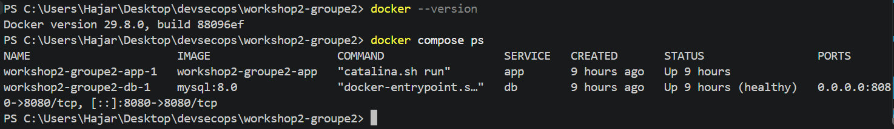

*Figure 1 : Conteneurs LiveChat et MySQL en cours d'exécution.*

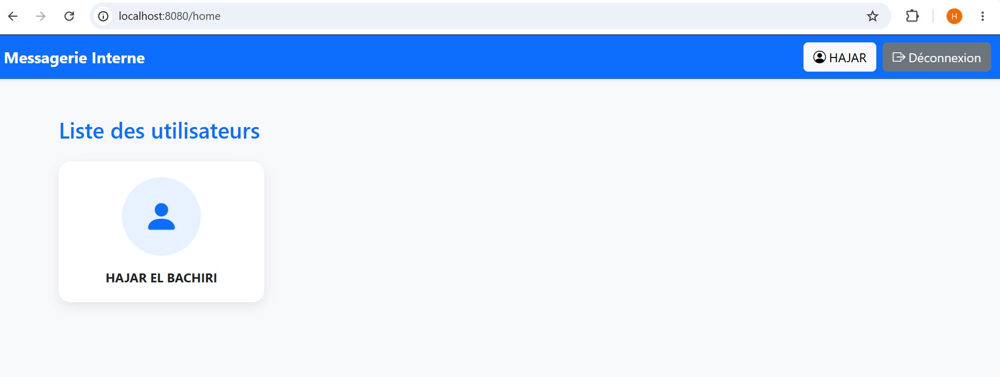

*Figure 2 : Page de LiveChat après connexion.*

### 4. Scan passif (baseline)

Commande exécutée :

```powershell
docker run --rm -v "${PWD}/reports/zap:/zap/wrk:rw" ghcr.io/zaproxy/zaproxy:stable zap-baseline.py -t http://host.docker.internal:8080 -r baseline-report.html -J baseline-report.json
```

Les rapports sont enregistrés dans `reports/zap/`.

#### 4.1 Code de sortie du scan

Le script `zap-baseline.py` se termine avec un **code de sortie 2**. Ce n'est pas une erreur d'exécution : le script utilise ce code pour résumer le résultat du scan.

| Code | Signification |
|---|---|
| 0 | Aucune alerte |
| 1 | Au moins une règle en échec (FAIL) |
| 2 | Au moins un avertissement (WARN), aucun échec |
| 3 | Erreur d'exécution du script |

À la fin du scan, le terminal affiche le résumé suivant :

```text
FAIL-NEW: 0     FAIL-INPROG: 0  WARN-NEW: 13    WARN-INPROG: 0  INFO: 0 IGNORE: 0       PASS: 55
```

`FAIL-NEW: 0` et `WARN-NEW: 13` correspondent à la ligne 2 du tableau : des avertissements, aucun échec. Par défaut, ZAP classe les règles en avertissement, et aucune n'est configurée en échec, d'où l'absence de FAIL. Le code est déduit de ce résumé, car il n'a pas été relevé directement sur ce premier scan ; il est mesuré sur le scan de contrôle de la section 8. C'est ce code que lit un pipeline CI pour décider si l'étape réussit ou échoue (voir section 9).

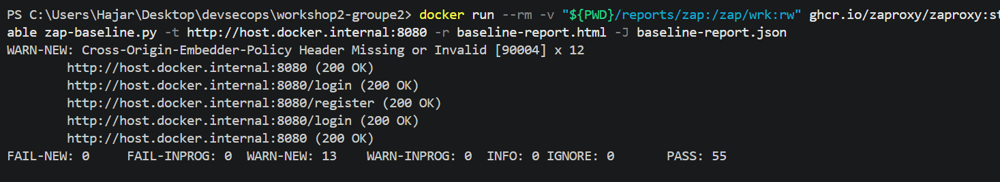

*Figure 3 : Résumé du scan passif dans le terminal.*

#### 4.2 Résultats

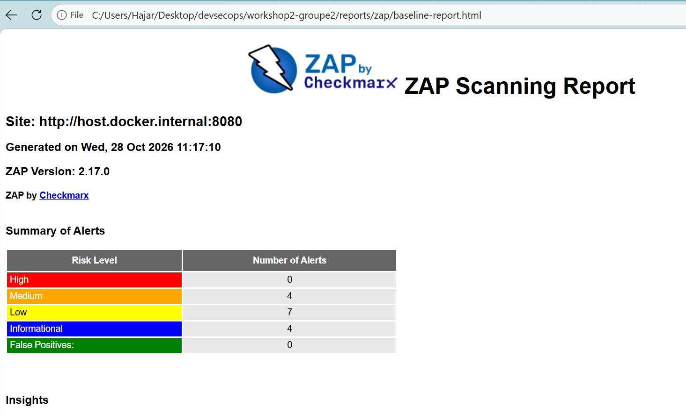

*Figure 4 : Synthèse des alertes par niveau de risque.*

Le scan a relevé 15 types d'alertes, dont aucune de niveau High :

| Niveau de risque | Nombre d'alertes |
|---|---|
| High | 0 |
| Medium | 4 |
| Low | 7 |
| Informational | 4 |

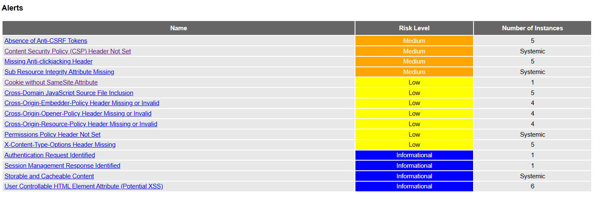

*Figure 5 : Liste des alertes du scan passif, avec leur niveau de risque et leur nombre d'instances.*

#### 4.3 Cookies

Une seule alerte concerne les cookies : *Cookie without SameSite Attribute*, sur le cookie de session `JSESSIONID` (1 instance).

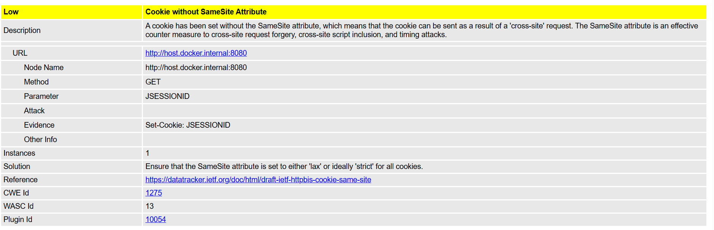

*Figure 6 : Alerte sur l'attribut SameSite du cookie JSESSIONID.*

| Cookie | HttpOnly | Secure | SameSite | Risque |
|---|---|---|---|---|
| `JSESSIONID` | Oui (vérifié avec `curl -I`, activé par défaut par Tomcat) | Non évalué (application servie en HTTP) | Absent | Faible |

`HttpOnly` empêche JavaScript de lire le cookie (protection contre le vol de session via XSS). `Secure` impose l'envoi en HTTPS uniquement. `SameSite` limite l'envoi du cookie dans les requêtes inter-sites (protection contre le CSRF). Les alertes sur `Secure` et sur HSTS n'apparaissent pas, car elles ne sont levées que sur des réponses HTTPS.

#### 4.4 En-têtes de sécurité manquants

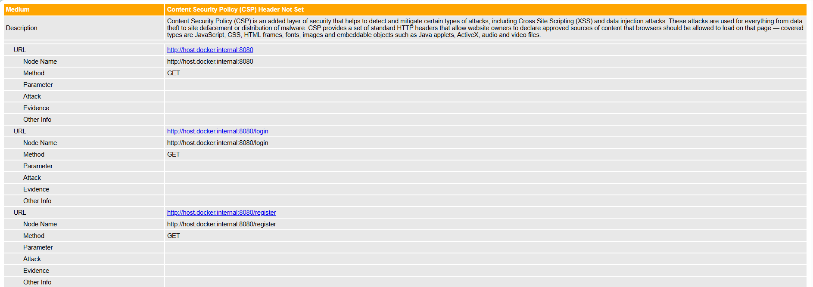
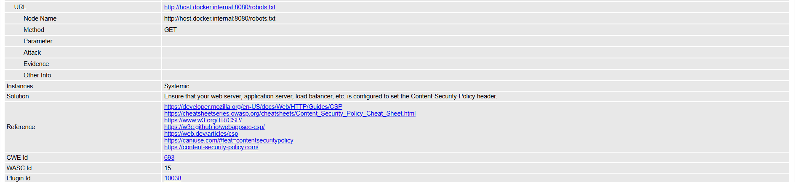

*Figure 7 : Alerte Content Security Policy (CSP) Header Not Set.*

| Alerte ZAP | Niveau | En-tête attendu | Rôle | Risque si absent |
|---|---|---|---|---|
| Content Security Policy (CSP) Header Not Set | Medium | `Content-Security-Policy` | Limite les sources de scripts autorisées | XSS |
| Missing Anti-clickjacking Header | Medium | `X-Frame-Options` ou `frame-ancestors` | Interdit l'inclusion de la page dans une iframe | Clickjacking |
| X-Content-Type-Options Header Missing | Low | `X-Content-Type-Options` | Empêche le MIME sniffing | Exécution de contenu détourné |
| Permissions Policy Header Not Set | Low | `Permissions-Policy` | Restreint les fonctions du navigateur (caméra, micro, géolocalisation) | Abus de fonctionnalités |
| Cross-Origin Embedder / Opener / Resource Policy | Low | `Cross-Origin-*` | Isole le contexte de la page des autres origines | Fuites inter-origines |

#### 4.5 Autres alertes notables

| Alerte ZAP | Niveau | Explication |
|---|---|---|
| Absence of Anti-CSRF Tokens | Medium | Les formulaires (connexion, inscription) n'incluent pas de jeton anti-CSRF : un site tiers pourrait déclencher des actions au nom d'un utilisateur connecté |
| Sub Resource Integrity Attribute Missing, Cross-Domain JavaScript Source File Inclusion | Medium / Low | Des scripts sont chargés depuis un domaine externe sans attribut `integrity` : si ce domaine est compromis, du code malveillant s'exécute dans LiveChat (risque de chaîne d'approvisionnement, lié au workshop 3) |
| User Controllable HTML Element Attribute (Potential XSS) | Informational | Des valeurs contrôlées par l'utilisateur apparaissent dans des attributs HTML : à vérifier lors du scan actif |

<!-- ============ PHASE 2 : ajouter la section 5 ============ -->

### 5. Scan actif (full scan)

> Réalisé uniquement sur l'instance locale de test. Le scan actif envoie de vraies attaques et crée de nombreux comptes dans la base : il ne doit jamais être lancé sur une application dont nous ne sommes pas propriétaires.

Le script `zap-full-scan.py` enchaîne l'exploration du site, l'analyse passive puis l'analyse active : son rapport contient donc à la fois les alertes passives du scan baseline (en-têtes, cookies) et les alertes actives (XSS, tests anti-CSRF). Le script `zap-baseline.py`, lui, se limite à l'analyse passive.

Commande exécutée (`-m 5` limite l'exploration à 5 minutes) :

```powershell
docker run --rm -v "${PWD}/reports/zap:/zap/wrk:rw" ghcr.io/zaproxy/zaproxy:stable zap-full-scan.py -t http://host.docker.internal:8080 -r full-report.html -J full-report.json -m 5
```

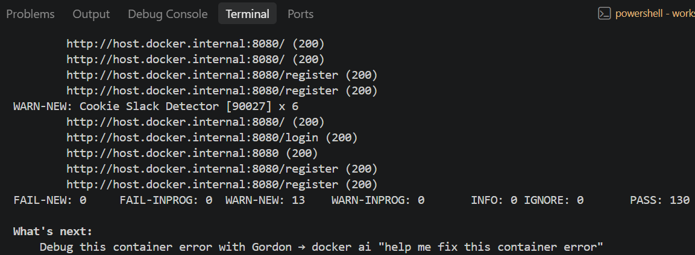

*Figure 8 : Résumé du scan actif dans le terminal.*

```text
FAIL-NEW: 0     FAIL-INPROG: 0  WARN-NEW: 13    WARN-INPROG: 0  INFO: 0 IGNORE: 0       PASS: 130
```

Le scan actif a exécuté 143 règles : 130 sont passées sans alerte, 13 ont produit un avertissement (code de sortie 2, comme pour le scan passif). Parmi les règles passées figurent l'injection SQL (y compris MySQL en mode temporel), le XSS persistant, le path traversal, l'injection de commandes, l'injection de templates, Log4Shell, Spring4Shell et XXE.

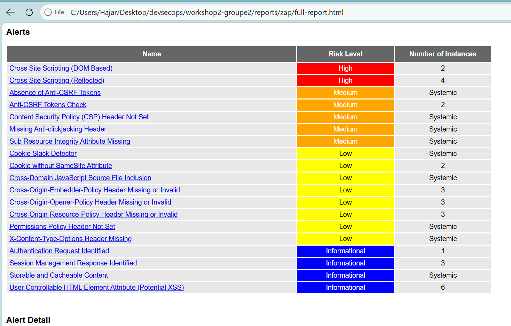

*Figure 9 : Synthèse du rapport du scan actif.*

| Niveau de risque | Nombre d'alertes |
|---|---|
| High | 2 |
| Medium | 5 |
| Low | 8 |
| Informational | 4 |

Le terminal annonce 13 règles en avertissement pour 15 alertes de niveau Low à High, car une même règle (Cross-Origin, n° 90004) produit trois alertes distinctes. Les alertes informationnelles sont classées PASS dans le terminal.

Par rapport au scan passif, le scan actif ajoute quatre alertes :

| Alerte ZAP | Niveau | URL | Instances |
|---|---|---|---|
| Cross Site Scripting (Reflected) | High | `/register` | 4 |
| Cross Site Scripting (DOM Based) | High | `/register` | 2 |
| Anti-CSRF Tokens Check | Medium | `/register`, `/login` | 2 |
| Cookie Slack Detector | Low | `/`, `/login`, `/register` | Systemic |

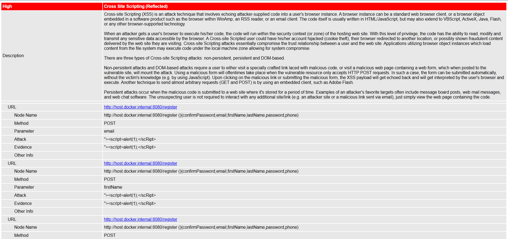
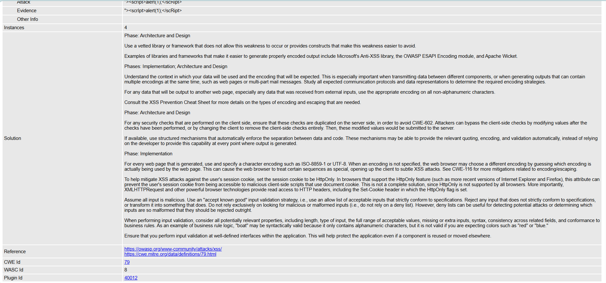

*Figure 10 : Détail de l'alerte Cross Site Scripting (Reflected) : URL, paramètre, attaque et preuve.*

| Champ | Valeur |
|---|---|
| URL | `<url>` |
| Méthode | `<GET/POST>` |
| Paramètre | `<paramètre>` |
| Attaque (payload) | `<payload>` |
| Preuve (evidence) | `<evidence>` |

**Limite de couverture** : le scan n'a exploré que 6 URLs (`/`, `/login`, `/register`, `robots.txt`, `sitemap.xml`...). Les pages situées derrière l'authentification, notamment le chat lui-même et ses WebSockets, ne sont pas atteintes par ZAP sans configuration d'une session authentifiée. L'absence d'alerte de XSS persistant ne prouve donc pas que le chat soit protégé.

<!-- ============ PHASE 3 : ajouter la section 6 ============ -->

### 6. Vérification manuelle

Un scanner automatique peut produire des faux positifs : chaque alerte importante doit être confirmée à la main.

**XSS réfléchi sur `/register`** : `<décrire la manipulation : champ rempli, payload saisi, ce qui s'est affiché>`

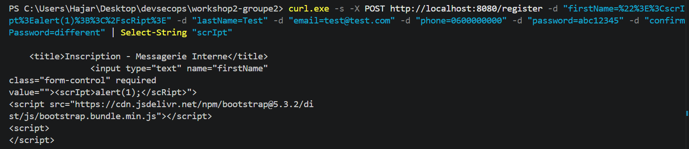

*Figure 11 : `<boîte d'alerte affichée, ou code source montrant le payload non échappé>`.*

**XSS basé sur le DOM** : `<URL du rapport ouverte dans le navigateur, résultat>`

**XSS stocké dans le chat (test manuel)** : `<message envoyé : , résultat>`

Conclusion : `<alerte confirmée / faux positif, avec la justification>`.

<!-- ============ PHASE 4 et 5 : ajouter les sections 7 et 8 ============ -->

### 7. Analyse des risques (DREAD et OWASP Top 10:2025)

Scores calculés avec la méthode vue en cours : Score = (D + R + E + A + D) / 5. Échelle : 0 à 3,3 faible, 3,4 à 6,6 moyen, 6,7 à 10 élevé.

| Vulnérabilité | D | R | E | A | D | Score | Niveau | Catégorie OWASP Top 10:2025 |
|---|---|---|---|---|---|---|---|---|
| XSS réfléchi sur `/register` | 6 | 8 | 8 | 5 | 8 | 7,0 | Élevé | A05 Injection |
| Absence de jeton anti-CSRF | 5 | 8 | 5 | 5 | 8 | 6,2 | Moyen | A01 Broken Access Control |
| En-têtes de sécurité manquants (CSP, anti-clickjacking) | 3 | 9 | 5 | 7 | 9 | 6,6 | Moyen | A02 Security Misconfiguration |
| Scripts externes sans contrôle d'intégrité | `<D>` | `<R>` | `<E>` | `<A>` | `<D>` | `<score>` | `<niveau>` | A03 Software Supply Chain Failures |

Justification des notes : `<une phrase par ligne : pourquoi ces valeurs>`.

### 8. Remédiation

Corrections appliquées, chacune dans un commit dédié :

| Problème | Correctif | Fichier modifié |
|---|---|---|
| En-têtes de sécurité manquants | Filtre Servlet qui ajoute `X-Content-Type-Options`, `X-Frame-Options`, `Content-Security-Policy` (directives `frame-ancestors`, `object-src`, `base-uri`, `form-action`), `Permissions-Policy`, `Referrer-Policy`, `Cross-Origin-Opener-Policy` et `Cross-Origin-Resource-Policy` | `src/main/java/util/SecurityHeadersFilter.java` |
| Cookie de session sans `SameSite` | Attribut `SameSite=Lax` configuré dans le contexte Tomcat | `src/main/webapp/META-INF/context.xml` |
| XSS réfléchi sur `/register` | `<échappement de la sortie : fichier et ligne>` | `<fichier>` |


*Figure 12 : Code du correctif.*


*Figure 13 : En-têtes de réponse HTTP après correction (`curl -I`).*

#### 8.1 Scan de contrôle après correction

```powershell
docker run --rm -v "${PWD}/reports/zap:/zap/wrk:rw" ghcr.io/zaproxy/zaproxy:stable zap-baseline.py -t http://host.docker.internal:8080 -r baseline-after-fix.html -J baseline-after-fix.json
```

Code de sortie relevé : `<valeur>`. Résumé : `<ligne FAIL-NEW / WARN-NEW / PASS>`.


*Figure 14 : Synthèse du scan passif après correction.*

| Alerte | Avant | Après |
|---|---|---|
| Content Security Policy (CSP) Header Not Set | Medium | `<résultat>` |
| Missing Anti-clickjacking Header | Medium | `<résultat>` |
| X-Content-Type-Options Header Missing | Low | `<résultat>` |
| Permissions Policy Header Not Set | Low | `<résultat>` |
| Cookie without SameSite Attribute | Low | `<résultat>` |
| Cross-Origin-Opener / Resource-Policy Header Missing | Low | `<résultat>` |
| Cross Site Scripting (Reflected) (scan actif) | `<niveau>` | `<résultat>` |

**Alertes volontairement non corrigées** :

| Alerte | Raison |
|---|---|
| Absence of Anti-CSRF Tokens | Demande une modification de chaque formulaire et de chaque servlet : prévue comme amélioration future |
| Sub Resource Integrity Attribute Missing | Demande de calculer l'empreinte de chaque script externe ou de les héberger localement |
| Cross-Origin-Embedder-Policy | `require-corp` empêcherait le chargement de scripts externes qui n'envoient pas l'en-tête adéquat |

<!-- ============ PHASE 6 : ajouter la section 9 ============ -->

### 9. Intégration CI/CD

Le fichier `.github/workflows/dast-zap.yml` lance le scan passif à chaque Pull Request vers `main` et à la demande :

1. **Checkout** du code.
2. **Démarrage de LiveChat** avec `docker compose up -d --build`.
3. **Attente** que l'application réponde sur `http://localhost:8080`.
4. **Scan ZAP baseline** avec l'option `-I`, qui évite d'échouer sur de simples avertissements ; une règle en échec (code 1) ou une erreur (code 3) fait en revanche échouer l'étape.
5. **Publication** du rapport HTML et JSON comme artefact du run.

Les actions GitHub sont épinglées sur un SHA de commit, comme dans le workflow du workshop 3.


*Figure 15 : Exécution du workflow DAST dans l'onglet Actions.*


*Figure 16 : Artefact `zap-report` téléchargeable.*

### 10. Discussion

**Limites du DAST**
- La couverture dépend de ce que ZAP découvre : sans session authentifiée, il n'atteint pas le chat ni ses WebSockets (6 URLs explorées).
- Faux positifs possibles : chaque alerte importante doit être vérifiée manuellement (section 6).
- Le scan actif est long, envoie de vraies attaques et pollue la base de données.
- Certaines alertes n'ont de sens qu'en HTTPS (`Secure`, HSTS) : elles ne peuvent pas être évaluées sur une instance locale en HTTP.

**Complémentarité SAST, SCA et DAST**
- Le SAST (workshop 2) trouve les défauts dans le code avant l'exécution.
- Le SCA (workshop 3) trouve les composants vulnérables ; il a par exemple signalé une dépendance transitive que les autres outils ne voyaient pas.
- Le DAST (workshop 4) teste l'application telle qu'elle est déployée : il détecte les défauts de configuration (en-têtes, cookies) et les failles d'exécution que l'analyse du code ne montre pas.

**Bonnes pratiques d'intégration dans un pipeline CI/CD**
- Scan passif (baseline) à chaque Pull Request : rapide et sans risque.
- Scan actif planifié (par exemple chaque nuit) sur un environnement de pré-production, jamais en production.
- Seuils de blocage (gating) : configurer certaines règles en FAIL avec un fichier de règles (`-c`) et conserver une liste des faux positifs acceptés.
- Scans authentifiés pour couvrir l'ensemble de l'application.
- Conservation des rapports comme artefacts pour tracer l'évolution.

### 11. Conclusion

`<5 à 6 lignes : ce que le workshop a permis d'apprendre, principales vulnérabilités trouvées, corrections apportées, résultat avant/après, limites>`

### 12. Livrables

- `reports/zap/` : rapports baseline, scan actif et scan après correction
- `.github/workflows/dast-zap.yml` : workflow CI du scan DAST
- `Dockerfile` et `docker-compose.yml` : exécution locale de LiveChat