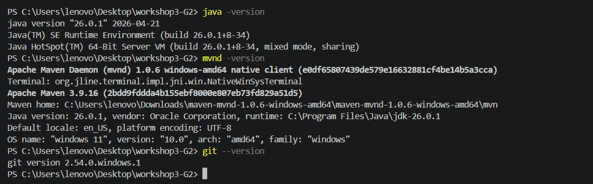
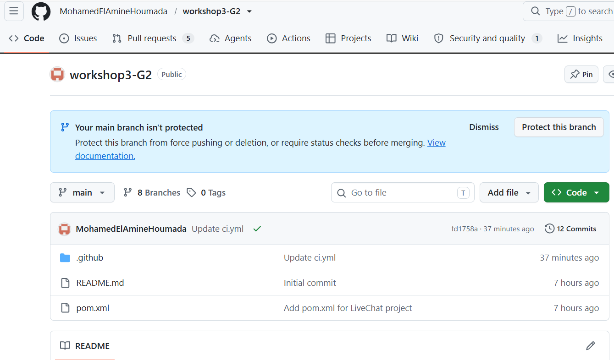
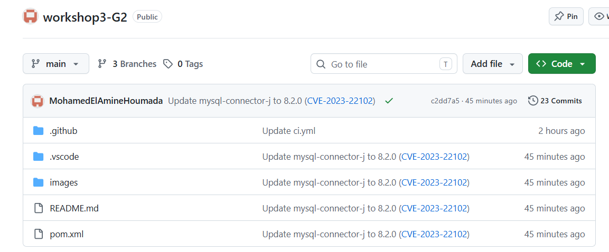
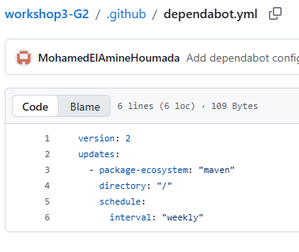
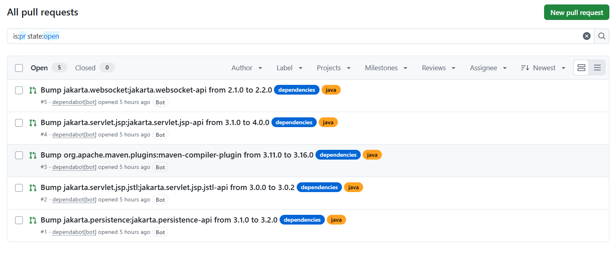
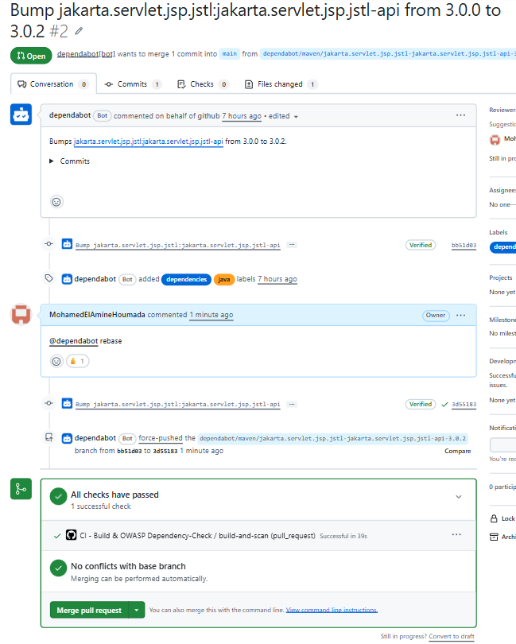
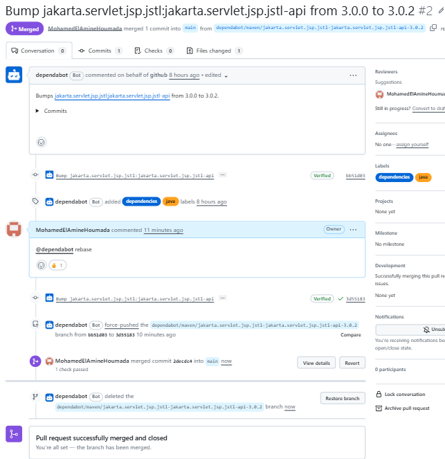
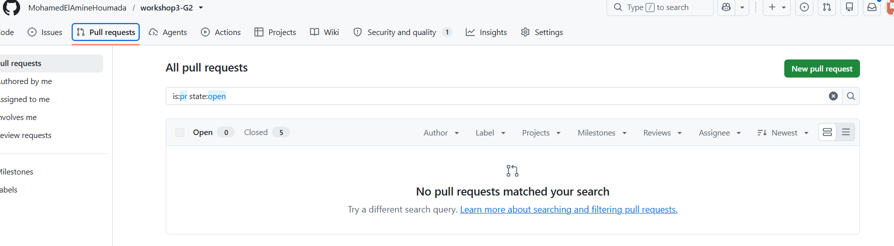
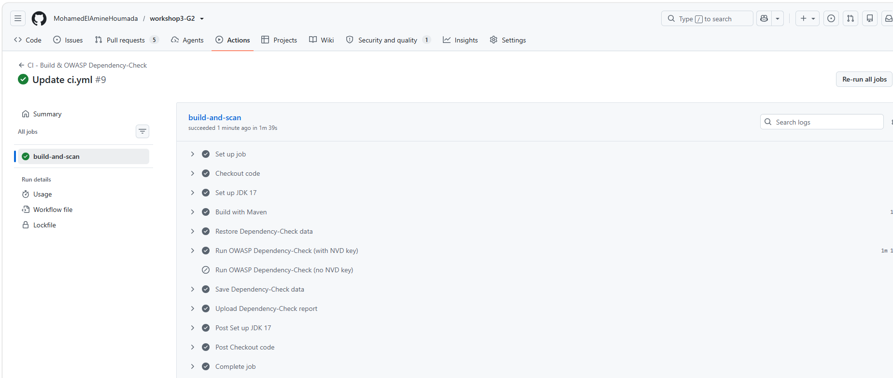
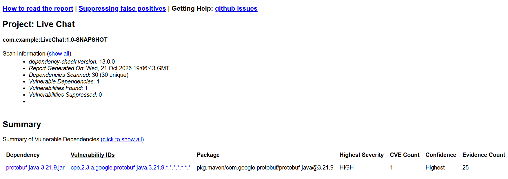

# Workshop 3 : Sécurité des dépendances (SCA)

**Dependabot & OWASP Dependency-Check**

- **Module** : DevSecOps, Master DevOps et Cloud Computing
- **Université** : Abdelmalek Essaâdi, FP Larache
- **Groupe** : G2
- **Membres** :
  - Hajar EL BACHIRI
  - Keltouma ACHGUER
  - Mohamed El Amine HOUMADA
- **Projet analysé** : Live Chat, application web Java/Maven (Jakarta EE, Hibernate, MySQL)
- **Dépôt** : https://github.com/MohamedElAmineHoumada/workshop3-G2

## 1. Objectif

Sécuriser les dépendances d'un projet Maven en utilisant :
- **Dependabot** : détection des dépendances vulnérables et mises à jour automatiques via des Pull Requests.
- **OWASP Dependency-Check** : analyse SCA qui compare les dépendances à la base NVD pour détecter les CVE.

Ces outils s'intègrent dans un pipeline CI/CD (GitHub Actions) pour appliquer le principe du *Shift Left*.

## 2. Définitions

|         Terme          |                                  Définition                                  |
|------------------------|------------------------------------------------------------------------------|
| Dépendance             | Bibliothèque externe utilisée par le projet, déclarée dans `pom.xml`         |
| CVE                    | Identifiant public d'une faille de sécurité connue                           |
| CVSS                   | Score de gravité d'une CVE, de 0 à 10                                        |
| SCA                    | Software Composition Analysis : analyse des composants tiers                 |
| NVD                    | National Vulnerability Database : base publique des CVE (NIST)               |
| Dependabot             | Outil GitHub qui alerte et propose des mises à jour de dépendances           |
| OWASP Dependency-Check | Outil SCA qui détecte les dépendances ayant des CVE connues                  |
| Pull Request (PR)      | Proposition de modification à relire avant fusion dans la branche principale |

## 3. Environnement de travail

Outils utilisés :
- Git, GitHub (dépôt + GitHub Actions)
- Java 26 et Maven 3.9.16 (via mvnd 1.0.6) en local ; le workflow GitHub Actions utilise Java 17 (Temurin), installé automatiquement
- Éditeur : Visual Studio Code



## 4. Mise en place du dépôt

Le dépôt `workshop3-G2` a été créé sur GitHub et alimenté avec le code du projet Live Chat. Le `pom.xml` déclare les dépendances suivantes :

|                      Dépendance                      |          Rôle           |
|------------------------------------------------------|-------------------------|
| Jakarta EE (Servlet, JSP/JSTL, WebSocket, JSON, EL)  | API web et temps réel   |
| `jakarta.persistence-api` / `hibernate-core`         | Accès aux données (ORM) |
| `mysql-connector-j` 8.0.33                           | Connexion à MySQL       |
| `gson` 2.12.1                                        | Sérialisation JSON      |
| `junit-jupiter` 5.10.2                               | Tests                   |




## 5. Pipeline CI : build Maven

Le workflow `.github/workflows/ci.yml` se déclenche à chaque `push` et pull request vers `main`, ainsi qu'à la demande (`workflow_dispatch`). Étapes :

1. **Checkout** du code.
2. **Set up JDK 17** (Temurin) avec cache Maven.
3. **Build with Maven** (`mvn clean verify`).
4. **Restore** du cache de la base de vulnérabilités.
5. **Run OWASP Dependency-Check** (voir section 10), avec clé API NVD et miroir de données.
6. **Save** du cache de la base, même en cas d'échec de l'étape précédente.
7. **Upload** du rapport (HTML et JSON) comme artefact du run.


## 6. Dependabot : configuration

Le fichier `.github/dependabot.yml` définit ce que Dependabot surveille.

```yaml
[À COMPLÉTER : coller ici le contenu exact de votre dependabot.yml]
```

|      Paramètre      |                              Rôle                              |
|---------------------|----------------------------------------------------------------|
| `version: 2`        | Version du format de configuration                             |
| `package-ecosystem` | Type de dépendances à surveiller (ici `maven`)                 |
| `directory`         | Dossier où se trouve le fichier de dépendances (`/` = racine)  |
| `schedule.interval` | Fréquence de vérification (`daily`, `weekly`...)               |

Cette configuration est à l'origine des 5 Pull Requests présentées en section 8.



## 7. Dependabot Alerts : état initial

Nous avons activé **Dependency graph** et **Dependabot alerts** dans *Settings → Advanced Security*. GitHub détecte **1 alerte** de gravité **High** :

|         Dépendance         |                 Alerte                  | Gravité |  Fichier  |
|----------------------------|-----------------------------------------|---------|-----------|
| `mysql-connector-j` 8.0.33 | MySQL Connectors takeover vulnerability | High    | `pom.xml` |

Cette alerte indique que la version utilisée du connecteur MySQL contient une faille connue. Il faut la corriger en passant à une version corrigée (voir section 9).


## 8. Pull Requests de Dependabot

Dependabot a ouvert **5 PRs** de mise à jour. Chacune comporte une description (avec un indicateur de compatibilité) et propose la modification du `pom.xml`.




### Analyse

| PR |                 Mise à jour                  |    Type     | Conflit |   Décision    |
|----|----------------------------------------------|-------------|---------|---------------|
| #1 | `jakarta.persistence-api` 3.1.0 → 3.2.0      | Mineure     | Aucun   | Fusionnée     |
| #2 | `jakarta.servlet.jsp.jstl-api` 3.0.0 → 3.0.2 | Correctif   | Aucun   | Fusionnée     |
| #3 | `maven-compiler-plugin` 3.11.0 → 3.16.0      | Mineure     | Aucun   | Fusionnée     |
| #4 | `jakarta.servlet.jsp-api` 3.1.0 → 4.0.0      | **Majeure** | Aucun   | Fusionnée     |
| #5 | `jakarta.websocket-api` 2.1.0 → 2.2.0        | Mineure     | Aucun   | Fusionnée     |

Règle appliquée : une PR est fusionnée si elle n'a pas de conflit avec `main`. Une mise à jour **majeure** (comme la PR #4, `jakarta.servlet.jsp-api` 3.1.0 → 4.0.0) peut casser la compatibilité (API changée, serveur d'application incompatible) : elle doit être testée après fusion.

Les 5 PRs ouvertes par Dependabot ont été fusionnées une par une dans `main`. Après les fusions, l'onglet *Pull requests* affiche **0 PR ouverte et 5 fermées**.

[À COMPLÉTER : résultat du build après les fusions (vert / en échec) et, si échec, la PR en cause]




## 9. Résultat après fusion

Les PRs ci-dessus sont des *version updates* : elles maintiennent les dépendances à jour mais ne ciblent pas spécifiquement la dépendance vulnérable. L'alerte sur `mysql-connector-j` reste donc ouverte tant que cette dépendance n'est pas mise à jour. Deux solutions :
- activer les **Dependabot security updates** (*Settings → Advanced Security*) : Dependabot ouvre alors une PR de correction pour l'alerte ;
- ou modifier manuellement la version dans `pom.xml` vers une version corrigée indiquée dans l'alerte.

Correction appliquée : [À COMPLÉTER : version de `mysql-connector-j` choisie, par exemple 8.x.x] ; état de l'alerte après correction : [À COMPLÉTER : fermée / toujours ouverte].


## 10. OWASP Dependency-Check

### 10.1 Principe

Le plugin Maven `dependency-check-maven` (version 13.0.0) analyse les dépendances du projet, les compare à la base NVD et produit un rapport (HTML et JSON) listant les CVE détectées avec leur score CVSS.

### 10.2 Clé API NVD et miroir de données

L'analyse télécharge toute la base NVD (plus de 400 000 enregistrements). Sans clé API, le téléchargement est très lent et limité. Nous avons donc :
- demandé une clé gratuite sur https://nvd.nist.gov/developers/request-an-api-key, activée par email, puis stockée dans un **secret GitHub** `NVD_API_KEY` (*Settings → Secrets and variables → Actions*). La clé n'apparaît jamais dans le code ni dans les logs ;
- configuré l'option `nvdDatafeedUrl` pour récupérer la base depuis le **miroir quotidien** publié par le projet Dependency-Check. L'API NVD n'est alors sollicitée que pour les mises à jour récentes, avec la clé.


### 10.3 Problèmes rencontrés et solutions

|                  Problème                  |                                          Cause                                          |                              Solution                               |
|--------------------------------------------|-----------------------------------------------------------------------------------------|---------------------------------------------------------------------|
| `Invalid API Key, length of 0`             | Aucune clé fournie : le client NVD échouait sans message clair                          | Création du secret `NVD_API_KEY`, deux steps conditionnels          |
| `Invalid API Key: xxxxx-*****-xxxxx`       | Le code de confirmation de l'email avait été utilisé à la place de la clé, non activée  | Activation de la clé, puis mise à jour du secret avec la vraie clé  |
| `No documents exist`                       | Conséquence de l'échec du téléchargement de la base NVD                                 | Disparaît une fois la base téléchargée                              |
| `Retrying request ...` (très nombreuses)   | API NVD surchargée : seulement 7 % de la base téléchargée après plus de 4 h             | Annulation du run, utilisation du miroir `nvdDatafeedUrl`           |
| Avertissements Node 20 / `setup-java@v4`   | Actions obsolètes                                                                       | Passage à `actions/checkout@v5` et `actions/setup-java@v5`          |

Après ces corrections, le job `build-and-scan` se termine avec succès en environ 1 min 40 s.

### 10.4 Résultats de l'analyse

- Vulnérabilités trouvées : [À COMPLÉTER : nombre total, depuis le rapport HTML]
- Répartition par gravité : Critical [X], High [X], Medium [X], Low [X]

|         Dépendance         |      CVE      | CVSS  | Gravité |         Action           |
|----------------------------|---------------|-------|---------|--------------------------|
| `mysql-connector-j` 8.0.33 | [À COMPLÉTER] | [X.X] | High    | Mise à jour vers [X.Y.Z] |
| [À COMPLÉTER]              | [À COMPLÉTER] | [X.X] | [ ]     | [ ]                      |





### 10.5 Seuil d'échec

Le build utilise `-DfailBuildOnCVSS=11` : il n'échoue jamais à cause des CVE (le score maximal est 10). Cette valeur est adaptée au contexte pédagogique. En production, on utiliserait par exemple `7` pour bloquer le build dès qu'une vulnérabilité High ou Critical est détectée.

## 11. Comparaison et conclusion

|         Critère         |                 Dependabot                 |            OWASP Dependency-Check            |
|-------------------------|--------------------------------------------|----------------------------------------------|
| Rôle                    | Alerter et proposer des mises à jour       | Scanner et produire un rapport de CVE        |
| Déclenchement           | Planifié (`schedule`) + alertes continues  | À chaque push / PR dans le pipeline          |
| Action sur le code      | Ouvre des Pull Requests                    | Aucune (rapport uniquement)                  |
| Base de vulnérabilités  | GitHub Advisory Database                   | NVD (NIST)                                   |
| Mise en place           | Fichier `dependabot.yml` + réglages GitHub | Plugin Maven + clé API NVD + workflow        |

Les deux outils sont **complémentaires** : Dependabot corrige en proposant des mises à jour, Dependency-Check vérifie à chaque build l'état des dépendances. Leur intégration dans la CI applique le principe du *Shift Left* : les vulnérabilités sont détectées tôt, avant la mise en production.

**Bilan du groupe**
- Dependabot est simple à mettre en place et réduit le travail de mise à jour, mais ses PRs de type *version update* ne ciblent pas forcément la dépendance vulnérable : il faut activer les *security updates* ou corriger manuellement.
- Les mises à jour majeures (comme `jakarta.servlet.jsp-api` 4.0.0) demandent une vérification avant fusion.
- OWASP Dependency-Check dépend fortement de la disponibilité de la base NVD : la clé API est indispensable, et un miroir de données ou un cache permet d'éviter des téléchargements très longs.
- Lire attentivement les logs a permis de distinguer une erreur de configuration (clé absente, clé non activée) d'un problème externe (API NVD lente).

## 12. Références

- Dependabot : https://docs.github.com/en/code-security/dependabot
- OWASP Dependency-Check : https://jeremylong.github.io/DependencyCheck/
- Plugin Maven : https://jeremylong.github.io/DependencyCheck/dependency-check-maven/
- NVD : https://nvd.nist.gov/