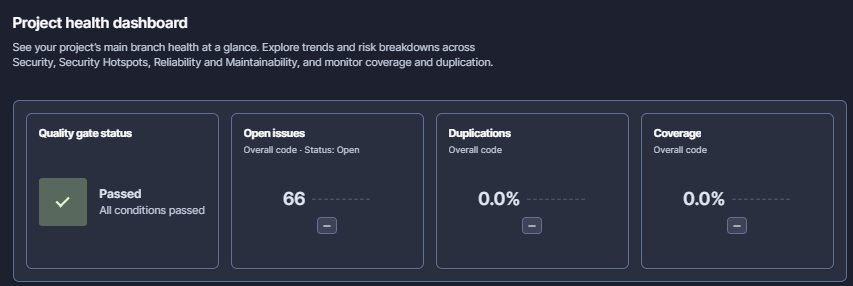
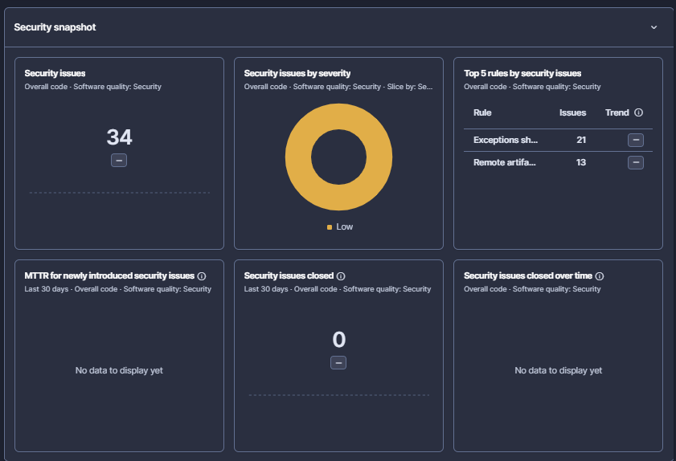
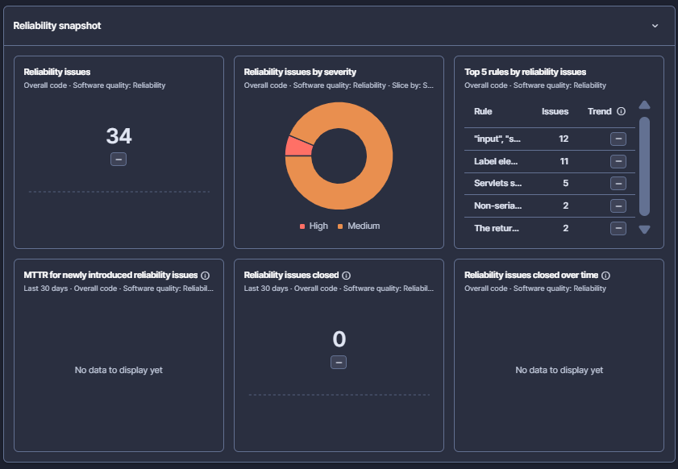
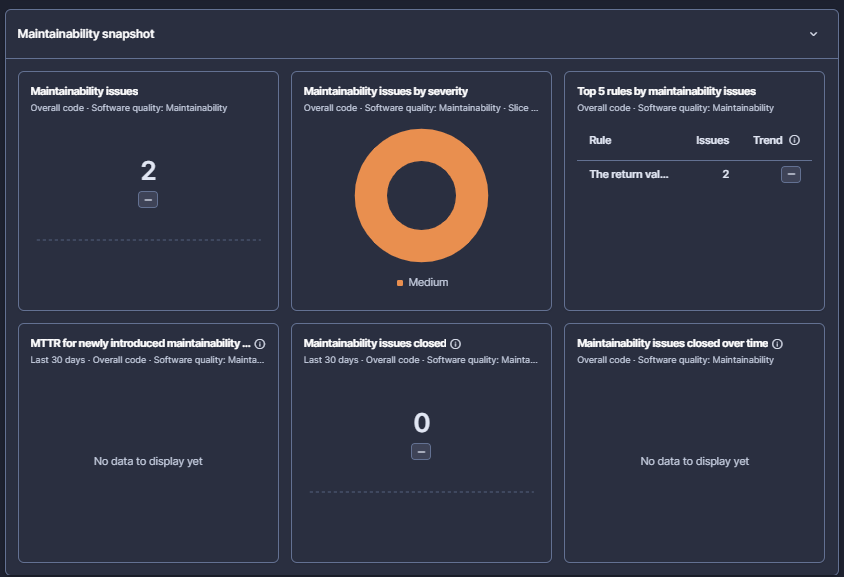
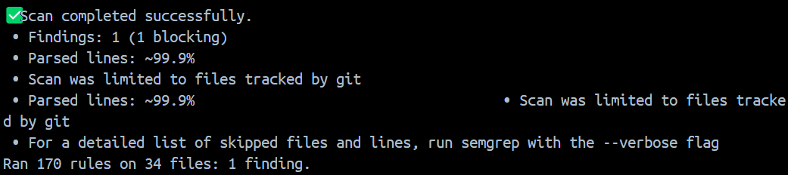
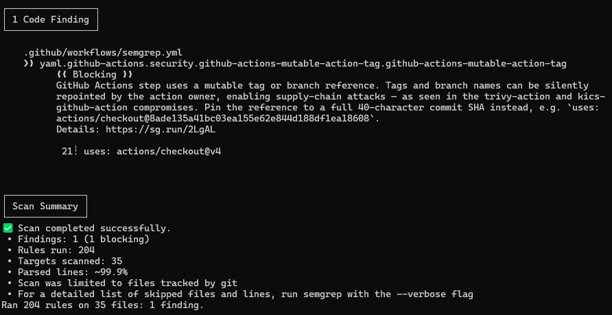
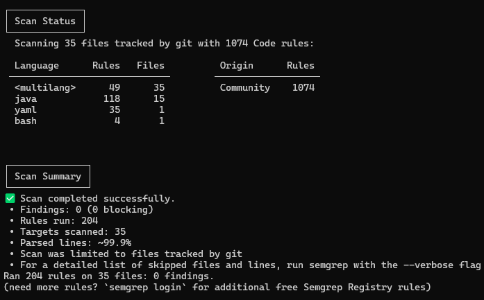
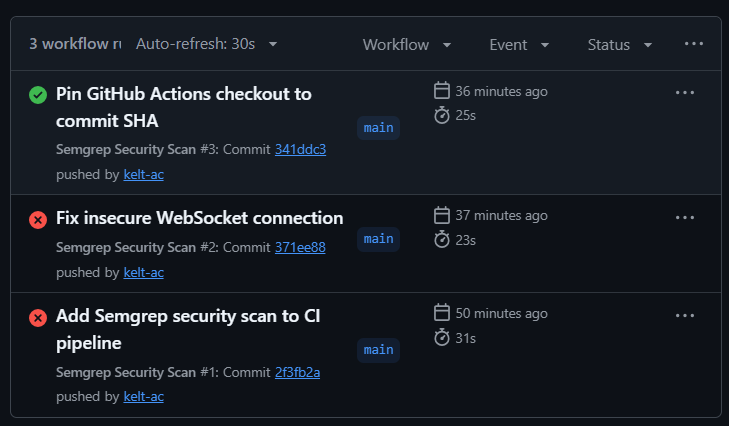

# Workshop 2 – Groupe 2
## Analyse de la qualité et de la sécurité du code

## 1. Présentation du projet

Ce projet a pour objectif d'analyser la qualité et la sécurité du code source à l'aide de SonarQube et de Semgrep, puis d'intégrer une analyse automatisée de sécurité dans un pipeline CI avec GitHub Actions.

Les objectifs sont :
- Détecter les problèmes de qualité et les vulnérabilités potentielles.
- Analyser le code source avec deux outils complémentaires.
- Automatiser l'analyse de sécurité à chaque modification du dépôt.
- Identifier et corriger les problèmes détectés.

## 2. Outils et technologies utilisés

- **Git et GitHub** : gestion du code source et du dépôt.
- **SonarQube** : analyse de la qualité du code et détection des problèmes.
- **Semgrep** : analyse statique du code et détection des problèmes de sécurité.
- **GitHub Actions** : automatisation de l'analyse dans un pipeline CI.
- **Docker** : exécution de SonarQube et Semgrep dans un conteneur.

## 3. Analyse avec SonarQube

SonarQube a été utilisé pour analyser le projet et examiner les indicateurs de qualité et les problèmes détectés.

Cette analyse permet notamment d'identifier :
- Les bugs potentiels.
- Les vulnérabilités de sécurité.
- Les code smells.
- Les indicateurs de qualité du projet.

### Captures d'écran



*Figure 1 : Tableau de bord général de SonarQube.*


*Figure 2 : Résultats et problèmes de sécurité détectés par SonarQube.*


*Figure 3 : Résultats et problèmes de fiabilité détectés par SonarQube.*


*Figure 4 : Résultats et problèmes de maintenabilité détectés par SonarQube.*


## 4. Analyse de sécurité avec Semgrep

Semgrep a été utilisé pour effectuer une analyse statique du code source.

La commande utilisée est :

```bash
docker run --rm \
  --mount "type=bind,source=$($PWD.Path),target=/src" \
  -w /src \
  semgrep/semgrep \
  semgrep scan --config auto .
```

Lors de l'analyse, Semgrep a examiné les fichiers suivis par Git et a notamment signalé :

- Une utilisation de `ws://` dans `src/main/webapp/chat.jsp`, correspondant à une connexion WebSocket non chiffrée.
- Une référence de version mutable `actions/checkout@v4` dans le workflow GitHub Actions.

Ces résultats ont permis d'identifier des améliorations possibles concernant la sécurisation des communications et la chaîne d'approvisionnement logicielle.

### Capture d'écran



*Figure 5 : Résultats de l'analyse statique avec Semgrep avant correction.*



*Figure 6 : Résultats de l'analyse statique avec Semgrep après correction.*



*Figure 7 : Résultats de l'analyse statique avec Semgrep après re-correction.*

## 5. Intégration dans un pipeline CI

Un workflow GitHub Actions a été créé dans le fichier :

`.github/workflows/semgrep.yml`

Le pipeline est déclenché lors :
- D'un `push` sur la branche `main`.
- D'une pull request ciblant `main`.
- D'un lancement manuel du workflow.

Le pipeline récupère le code source, exécute Semgrep et utilise le résultat de l'analyse pour déterminer si l'étape de sécurité réussit ou échoue.

Cette intégration permet de détecter automatiquement certains problèmes de sécurité au cours du développement.

### Capture d'écran



*Figure 8 : Intégration et exécution du pipeline CI sur GitHub Actions.*

## 6. Corrections et vérifications

Les analyses ont permis d'identifier des problèmes potentiels dans le code applicatif et dans la configuration du pipeline.

Les actions envisagées ou réalisées comprennent :
- L'adaptation du protocole WebSocket pour utiliser une connexion sécurisée en production avec HTTPS/WSS.
- Le verrouillage de l'action GitHub `actions/checkout` sur un SHA de commit précis.
- La relance de l'analyse Semgrep après les modifications.
- La vérification de la compilation, des tests et du fonctionnement de l'application.

Les corrections sont considérées comme validées après vérification des résultats des analyses et des tests.

## 7. Conclusion

L'utilisation combinée de SonarQube, Semgrep et GitHub Actions permet d'améliorer le suivi de la qualité et de la sécurité du projet.

SonarQube fournit une vue d'ensemble de la qualité du code, tandis que Semgrep permet de détecter des problèmes de sécurité potentiels. L'intégration de Semgrep dans un pipeline CI automatise ces vérifications et facilite la détection précoce des problèmes lors des modifications du code.

Cette réalisation constitue une première étape vers une démarche d'intégration continue intégrant des contrôles de qualité et de sécurité.
